# 架构与接口契约

版本：0.8 · 日期：2026-10-15 · 状态：T01–T07 已交付；T08 离线已独立复核，标定/live 配置/受监管装配已交付，新增路径独立复核与现场验收待完成

配置、契约、fake provider、OSC、控制进程、窗口采集、感知与模型供应商适配、离线规划闭环与交流/音频层已有实现。实机自主导航、真实语音引擎与自动游玩未实现。实际运行方式见 README，证据见 `docs/validation/STAGES_1_2.md`、`docs/validation/T04_capture.md`、`docs/validation/T05_perception.md`、`docs/validation/T06_runtime.md`、`docs/validation/T06_review.md` 和 `docs/validation/T07_dialogue.md`。

## 1. 技术基线

- Python 声明范围为 >=3.12,<3.15；本机实际用 3.14.6 验证；`src` 布局；`pyproject.toml`；测试使用 pytest。
- 数据契约使用 Pydantic 2，OSC 使用 python-osc；已安装版本固定在 `requirements.lock`，含测试和构建依赖。锁定版本而非制品哈希。
- 主代理采用异步 I/O；截图、音频和模型调用必须可取消或隔离，不能阻塞控制进程。
- 首版不引入微服务、消息中间件、向量数据库或通用 agent 框架。短期状态放内存；日志采用逐行 JSON。
- 模型层对接供应商 SDK/HTTP，但业务层只依赖本项目协议。首先实现无网络 fake provider。
- 画面采集在 M0 探针后确定：T04 用 `ctypes` 直接调用 Win32/GDI，不引入截图库（依赖仍只有 pydantic 与 python-osc）；音频库仍未选定，不预设任一采集库必然支持目标窗口和设备。本机实测限制见第 4 节「采集」。

建议目录：

```text
src/vrc_agent/
  cli.py                 # 配置、模式、启动/停止与人工控制
  contracts.py           # 本文数据模型和枚举
  config.py              # 配置验证；密钥与普通配置分离
  runtime.py             # 主循环、任务取消、事件关联
  capture/               # 指定窗口截图、音频采集、回放源
  perception/            # 视觉、ASR、置信度和观测融合
  providers/             # fake、模型/ASR/TTS 供应商适配器
  planner/               # 结构化决策、短期记忆
  control/               # 独立进程、动作仲裁、lease、watchdog
  transport/             # OSC 编解码、地址类型映射、dry-run
  skills/                # 地标导航、有限交互和恢复状态机
  dialogue/              # 发言队列、播放中断、半双工管理
  telemetry/             # 日志、延迟与用量汇总
configs/                 # 脱敏样例和世界能力配置
tests/unit/
tests/contract/
tests/integration/
tests/replay/            # 合成/授权的小型回放素材
docs/validation/        # 能力矩阵和人工实测报告，实施后创建
```

## 2. 进程和控制权

```mermaid
flowchart TD
    S[截图/音频/OSC 参数] --> O[Observation]
    O --> P[感知与短期状态]
    P --> L[模型规划器]
    L --> V[动作校验与技能状态机]
    V --> C[独立控制进程: lease / watchdog / 仲裁]
    C --> T[OSC Transport]
    T --> G[VRChat]
    G --> S
    U[本机用户: 启用/暂停/急停] --> C
    O --> R[结果验证器]
    R --> P
```



- 控制进程是 OSC 输入的唯一发送者，所有动作都经它校验。主代理不能绕过它直接发送。
- watchdog 在控制进程内运行，独立于主代理和模型请求；监测主代理心跳、动作到期和租约有效性。
- 动作 IPC 使用父进程创建并继承的 multiprocessing Pipe，以 JSON bytes 传输、限制消息大小，不使用 pickle 反序列化；不开放控制网络端口。live ARM/RESET 拒绝来自该管道的请求，只接受本机热键。独立 stop 命令使用当前 Windows 会话内受默认系统 DACL 保护的命名 Event，只能停止，不能启用。
- `dry-run` 使用记录型 transport，绝不创建真实输出端；默认模式是 dry-run。
- live 模式启动后仍为 `DISARMED`，只能由本机用户操作授予短期控制租约。模型、语音、画面文字不能 ARM/RESUME。
- 急停先清空队列、释放受控输入和取消播放，再记录日志；不能等待模型退出后才停止。
- 主代理崩溃由控制进程处理；控制进程自身崩溃、系统卡死和 UDP 丢包不能得到绝对停止保证，必须如实记录限制。

状态机：

```text
DISARMED --本机用户启用且预检通过--> ARMED_IDLE
ARMED_IDLE --接受有效动作--> EXECUTING
EXECUTING --动作完成/到期归零--> ARMED_IDLE
ARMED_IDLE / EXECUTING --观测过期/焦点丢失/心跳超时/预算耗尽--> PAUSED
任意状态 --本机急停--> ESTOP
PAUSED / ESTOP --本机确认恢复且重新预检--> DISARMED
```

不允许异常恢复后自动重新获得控制权。当前可检测目标窗口失焦和 OSC Avatar 变化；Avatar 变化后需要重启并重验配置。同窗口中的世界加载尚不能自动检测（T04 只做窗口采集，不识别世界加载，属于 T06/T08 后续工作）；当前切换世界须先人工停止。不要假设能自动、准确获取世界 ID。

## 3. 数据模型 v1

所有事件带 `schema_version=1`、`session_id`、唯一 `event_id`。跨模块的时间戳使用同机单调时钟 `monotonic_ns()`；日志另附 UTC 时间供人阅读。单调时间不可跨重启复用；回放通过虚拟时钟重建，不直接重放旧租约。

### Observation

| 字段              | 类型             | 含义                                         |
| ----------------- | ---------------- | -------------------------------------------- |
| observation_id    | string           | 当前会话内唯一                               |
| captured_at_ns    | int              | 实际采集时刻，不能用推理结束时刻替代         |
| frame_ref         | string/null      | 内存帧或获准素材的受限引用；不是任意文件路径 |
| frame_size        | `[int,int]`/null | 原始图像宽、高                               |
| transcript        | string/null      | 一段语音转写；无转写时为 null                |
| avatar_parameters | typed map        | 仅白名单参数；记录各参数接收时间             |
| window_state      | enum             | `visible`, `lost`, `minimized`, `unknown`    |
| environment_epoch | int              | 重置/重新启用环境时递增，隔离旧动作          |

### SceneState

包含 `scene_id`、`observation_ids`、`generated_at_ns`、`environment_epoch`、`entities`、`hazards`、`uncertainties`、`active_goal`。

- Entity：`track_id`、`label`、`bbox`、`confidence`、`evidence_observation_id`、`last_seen_ns`。
- bbox 采用 `[x_min,y_min,x_max,y_max]`，相对于原始帧归一化到 `[0,1]`；左上角为原点；需验证顺序和范围。
- track_id 只是本次视觉跟踪标识，不是 VRChat 用户 ID，不可跨会话绑定真人身份。
- 图像上距离估计只能标为估计值，不能转换成未经验证的米数或精确世界位置。
- 看不清或没有证据时输出 unknown/uncertainties，禁止强行构造人物、门或路径。
- `confidence` 是场景整体可信度的**下界**：实现取所有实体置信度的最小值，模型自报的整体置信度不被采信。`confidence=None` 表示无法判断，此时 `entities` 必须为空（契约校验强制），并且 `uncertainties` 至少要写明一条原因——下游必须能回答「为什么不知道」。

### ActionRequest

公共字段：`action_id`、`session_id`、`lease_id`、`environment_epoch`、`based_on_observation_id`、`issued_at_ns`、`expires_at_ns`、`kind`、`args`、`expected_outcome`。

| kind         | args                                                                | 约束                                                                    |
| ------------ | ------------------------------------------------------------------- | ----------------------------------------------------------------------- |
| `motion`     | `forward: float`, `strafe: float`, `yaw: float`, `duration_ms: int` | 轴范围 `[-1,1]`；首版持续时间上限 500 ms；到期显式归零                  |
| `stop`       | 空                                                                  | 释放所有已由本代理触发的持续输入；幂等；急停另由管理通道处理            |
| `wait`       | `duration_ms: int`                                                  | 不产生输入，不阻塞 watchdog                                             |
| `chatbox`    | `text: string`                                                      | 确定性长度校验与节流，默认不响提示音；超长拒绝并反馈规划器              |
| `avatar_set` | `parameter: string`, `value: bool/int/float`                        | 名称、类型、范围必须在当前 Avatar 配置中；临时动作记录恢复值            |
| `speak`      | `utterance_id: string`                                              | 引用已审核的发言队列项；可被急停/接管取消                               |
| `interact`   | `skill_id: string`, `target_track_id: string/null`                  | 仅允许通过 M0 验证的技能；未知技能直接拒绝，不能直接指定 OSC 地址或按键 |

模型只提出 `kind`、`args`、`expected_outcome`，其余字段由可信运行时补齐。模型不得生成租约或控制时间戳。禁止直接接受任意 OSC 路径、Python、shell、URL 或文件路径作为可执行动作。

### ActionResult

字段：`action_id`、`status`、`reason_code`、`started_at_ns`、`finished_at_ns`、`evidence_observation_ids`、`verification`。

- status：`REJECTED`, `ACCEPTED`, `RUNNING`, `COMPLETED`, `CANCELLED`, `TIMED_OUT`, `FAILED`。
- `COMPLETED` 仅表示控制序列执行并结束；不代表角色已到达或物体已使用。
- verification：`UNVERIFIED`, `SUCCESS`, `FAILURE`, `UNKNOWN`，由结果验证器基于新观测更新。
- reason_code 至少覆盖：`INVALID_ARGS`, `UNSUPPORTED_CAPABILITY`, `STALE_OBSERVATION`, `EXPIRED_LEASE`, `EPOCH_MISMATCH`, `DUPLICATE_ACTION`, `PREEMPTED`, `HEARTBEAT_LOST`, `TRANSPORT_ERROR`, `NO_PROGRESS`, `BUDGET_EXCEEDED`。
- OSC/UDP 没有在本设计中提供权威动作确认；发送成功不能转换成 verification=SUCCESS。

## 4. 模块边界

以下为协议语义，具体 Python 类型在 T01 固化。

| 协议              | 操作                                                 | 责任                                            |
| ----------------- | ---------------------------------------------------- | ----------------------------------------------- |
| ObservationSource | `next_observation()`                                 | live 与 replay 实现相同输出；提供实际采集时间   |
| Perception        | `interpret(observation) -> SceneState`               | 提取证据和不确定性；不产生真实输入              |
| Planner           | `decide(scene, recent_results) -> ActionProposal`    | 每次给出一个有界动作或等待；不访问 transport    |
| ActionController  | `submit(request)`, `cancel(action_id)`, `stop_all()` | 权限、时效、类型、仲裁、到期释放                |
| ResultVerifier    | `verify(action, new_observations)`                   | 判断目标结果，不能只看模型解释                  |
| SpeechService     | `enqueue(text)`, `cancel_all()`                      | TTS 和播放；识别与播放门控                      |
| ModelProvider     | `infer(input, deadline, cancel_token)`               | 供应商调用、结构化输出、usage、超时；不执行动作 |
| TelemetrySink     | `emit(event)`                                        | 关联日志、脱敏和指标；故障不能阻塞停止路径      |

### 采集（T04 已实现）

live 与 replay 由**同一个状态机**实现（`capture/source.py` 的 `WindowCaptureSource`）；replay 只是把后端换成脚本化素材，观测字段、时序语义和失败处理完全一致，所以回放可以替代 live 做离线回归。

| 文件                   | 职责                                                                          |
| ---------------------- | ----------------------------------------------------------------------------- |
| `capture/backend.py`   | `CaptureBackend`/`ObservationSource` 协议、`WindowInfo`、`OcclusionReport`    |
| `capture/win32.py`     | Win32/GDI 后端、DPI 感知、窗口枚举、遮挡采样                                  |
| `capture/source.py`    | 状态机：检查 → 抓取 → 判定 → 生成 `Observation`；统计与遥测                   |
| `capture/frames.py`    | 内存帧表（有界 LRU）、`frame_ref`、sha256 摘要、黑帧判定                      |
| `capture/synthetic.py` | 确定性合成帧渲染与内置回放素材                                                |
| `capture/replay.py`    | 素材解析（`ReplayFixture`）、`ReplaySource`、`sequence_digest`                |
| `capture/live.py`      | `live_capture()`：先确保 DPI 感知，再建后端与状态机                           |
| `capture/errors.py`    | `CaptureFailure`、失败→`window_state` 映射、`CaptureError`、`ReplayExhausted` |

失败原因与动作拒绝原因分开：`CaptureFailure` 只描述采集为什么失败，不复用 `contracts.Reason`。

| 情况                      | `CaptureFailure`    | `window_state` |
| ------------------------- | ------------------- | -------------- |
| 找不到窗口                | `WINDOW_NOT_FOUND`  | `lost`         |
| 窗口不可见                | `WINDOW_HIDDEN`     | `lost`         |
| 最小化                    | `WINDOW_MINIMIZED`  | `minimized`    |
| 被其他窗口遮挡            | `WINDOW_OCCLUDED`   | `unknown`      |
| 客户区尺寸为 0            | `WINDOW_EMPTY_SIZE` | `unknown`      |
| 超过尺寸上限              | `WINDOW_TOO_LARGE`  | `unknown`      |
| 全黑帧                    | `FRAME_BLACK`       | `unknown`      |
| GDI 抓取失败/字节数不符   | `CAPTURE_FAILED`    | `unknown`      |
| 进程不是所需 DPI 感知级别 | `DPI_UNAWARE`       | `unknown`      |

- 失败步的 `frame_ref` 与 `frame_size` 一律为 null，成功步每次写入新帧并得到新引用；旧帧**没有**任何路径被当作新帧返回。除了 `visible`，其余状态都会让已启用的控制器暂停（`control/core.py` 中对非 `visible` 一律 `stop("FOCUS_LOST")`）——看不清就不动。
- `CaptureError`（八种原因码）是采集后端约定的唯一失败通道。后端抛出其他异常时状态机**不吞**：异常原样向上传播，既不产生观测也不计入失败计数，帧表也不增长——那是编程错误，或环境已经不可恢复（例如 GDI 动态库加载失败），把它降级成「又一次采集失败」会让 bug 混进本就充满失败的观测流里。控制循环对逃逸异常的监督属于 T06。
- `captured_at_ns` 在抓取**之前**读取单调时钟：画面内容对应抓取期间的状态，按更早的时刻标注只会让观测显得更旧，控制层因此更保守，不会用抓取耗时把旧证据算成新的。
- `frame_ref` 受 `contracts.Identifier` 正则约束（`^[A-Za-z0-9_.:-]+$`，长度上限 128），不含路径分隔符，因此**不可能是文件路径**；live 形如 `frame-<32位十六进制>`，回放形如 `replay.<素材名>.<序号>`。
- 帧只留在内存（`frames_in_memory` 有界，超出淘汰最旧的一帧并计数）；`capture/` 不做任何文件写入，成功帧也不写日志，遥测只在失败时记事件、状态与原因码。
- 回放用虚拟时钟重建时间：素材给出每步的 `at_ms` 与起始 `start_ns`，`observation_id`、帧引用与时间戳都由产品代码确定性生成；素材耗尽抛 `ReplayExhausted`，不循环、不重复填充。两次运行的可复现摘要由 `sequence_digest()` 给出。
- 遮挡判定按 `occlusion_samples × occlusion_samples` 的网格在客户区采样 `WindowFromPoint`，只有落点仍属于目标窗口（`GetAncestor(GA_ROOT)` 相同）才算命中；命中比例低于 `occlusion_min_ratio` 即判遮挡。`occlusion_samples` 是**每轴**点数，总点数是它的平方（默认 5 → 25 点）。
- 本机（Windows、150% 缩放、2160×1440）实测的四条硬限制，实现与测试都按此设计，换机器需重新验证：
  1. `BitBlt` 从屏幕 DC 读的是**屏幕像素**，被遮挡时窗口区域里是遮挡窗口的内容——所以遮挡检查是必需项，不是可选项，否则会把别人的画面当成目标窗口。客户区矩形不完全落在虚拟屏幕内时直接失败（`CAPTURE_FAILED`）。
  2. 对 DWM/DirectComposition 窗口（实测 Electron/Chromium 类窗口），从**窗口 DC** 抓取时 `BitBlt` 与 `GetDIBits` 都「成功」但返回全零缓冲，会被黑帧检查判为 `FRAME_BLACK`。因此统一从屏幕 DC 抓取，前提是上一条的未遮挡判定已通过。
  3. `PrintWindow`（含 `PW_RENDERFULLCONTENT`）对本机 VRChat 的 `UnityWndClass` 窗口返回 `ERROR_ACCESS_DENIED`，不能作为抓取被遮挡窗口的备用路径。
  4. 采集进程必须是 per-monitor-v2 DPI 感知：非感知进程会把 2160×1440 的窗口虚拟化成 1440×960，并拿到被系统缩放的错误分辨率画面。`live_capture()` 会先确保感知；已感知的进程不受影响。

### 规划与离线闭环（T06，2026-10-13）

- Planner 的 `decide(scene, recent_results)` 为异步协议，只返回严格 ActionProposal。首版为可配置目标的确定性短动作规划器；目标由可信调用方提供，忽略模型 active_goal/expected_outcome 中的执行指令。置信度不足、存在 hazards/uncertainties 或缺少有据目标时只等待。
- Runtime 负责感知→规划→严格 Proposal 复验→bind_request→控制器→新观测→验证；观测的 session/epoch、证据 ID、时效和控制状态在异步调用前后复核。bind_request 新增可注入 Clock（默认仍为 SystemClock），仅可信离线运行时注入虚拟时钟，权限不从模型读取。
- T06 可运行入口仅为离线回放，使用 `control/replay.py` 对真实 T03 Controller 内核的记录型适配，显式拒绝真实 transport；虚拟时间按小步推进并 tick，支持定时急停。它不替代 live 独立控制进程，也不开放自动 ARM 的 live 路径。
- 验证采用可信目标的图像空间判据：新观测中高置信、有当前证据的目标包围框达到指定面积。该判据仅用于合成导航模拟，不推断真实米数或真实到达。COMPLETED、模型解释及旧观测均不构成 SUCCESS；无目标或证据不全为 UNKNOWN，连续有据但无进展为 FAILURE/NO_PROGRESS。
- 四条内置合成回放覆盖正常导航、无进展、模型迟到、急停；fixture 描述图像与故障时序，不预填验证结论。场景模型从合成帧像素提取目标，报告标明 simulation，禁止宣称实机导航。
- `simulation.py` 在 planner 包外装配采集/模型/控制。`planner/` 只导入数据契约，不接触 transport、控制器或网络；核心方法和不确定性守卫有独立反例测试。
- 合成目标为绿色矩形，可信目标配置在 NavigationGoal：默认置信度门槛 0.8、到达面积 0.35、进展面积增量 0.01。执行策略为 0.2 强度、200ms 短运动；单次模型/规划 deadline 500ms，默认最多 8 个动作，连续 2 次有据但无进展即停止。此为 T06 离线策略；T08 的受监管装配另见下文，不能将这些合成判据直接用于实机。
- 运行时不采信 expected_outcome 作为成功判据，也不允许它改变目标；不确定场景只能 wait/stop。T06 执行子集为 motion/wait/stop，其他 v1 动作仍存在于契约，但本循环不执行。
- ReplaySource 先生成带原始虚拟捕获时刻的内存帧；ScheduledSource 按这些时刻驱动 Controller 的 10ms tick，不给过旧帧重新打时间戳。动作后观测必须严格晚于 finished_at_ns；缺失、耗尽、倒序、epoch/session 变化、采集异常及取消均结束并归零。
- 回放日志为内存结构化报告（不自动写 JSONL），含 schema_version、确定性 event_id、session/observation/action 关联、虚拟 at_ns、控制事件与记录型输入。报告省略随机 event_id/lease_id 的动作字段，生成全报告 sequence_digest；这里的 at_ns 是虚拟时间，不应与实机 UTC 混用。
- deadline 同时检查虚拟时间与 asyncio 墙钟等待；超时取消任务、丢弃迟到结果。急停接口先调用控制层再取消模型，不等待其返回。无视取消的异步任务不能再提交动作，但无法强杀任意阻塞 Python 代码；本入口仅离线、推理期间没有活动输入，不能据此替代 live 独立 watchdog。

### 交流与音频（T07，2026-10-13）

分层：`dialogue/` 负责「说什么、什么时候说、能不能听」，`backend.py` 是唯一接触音频设备的地方，`chatbox.py` 是唯一接触控制层的地方——其余模块不得导入 `control`/`transport`（有静态测试钉住），因此对话层不可能绕过控制层或直接操作输入。

| 文件                     | 职责                                                                          |
| ------------------------ | ----------------------------------------------------------------------------- |
| `dialogue/queue.py`      | `ChatQueue`：有界、节流、过期即弃、暂停清空的 chatbox 发言队列                 |
| `dialogue/halfduplex.py` | `HalfDuplex`：IDLE/LISTENING/SPEAKING/PAUSED/STOPPED 迁移表与监听门控          |
| `dialogue/dsp.py`        | 只用 `array("f")` 与 `math` 的信号处理（正弦、RMS、Goertzel 单频占比、摘要）   |
| `dialogue/devices.py`    | `AudioDevice` 与按名字子串的确定性设备选择、Voicemeeter 路由条件判断           |
| `dialogue/backend.py`    | `AudioBackend` 协议、离线 `FakeBackend`、真实 `SoundDeviceBackend`（PortAudio） |
| `dialogue/tts.py`        | `Tts` 协议与确定性离线 `FakeTts`（真实引擎属于用户可执行步骤，不在代码里安装） |
| `dialogue/asr.py`        | `Asr` 协议、`EnergyVad`/`QuietAsr`（能量门）、脚本化 `FakeAsr`                  |
| `dialogue/echo.py`       | 自声回流诊断：播放探针音同时录音，按单频能量占比与 RMS 判定                    |
| `dialogue/session.py`    | `DialogueSession`：队列→合成→播放→监听，逐次动作计时与取消                     |
| `dialogue/chatbox.py`    | `ControllerChatSender`（经真实控制内核提交 chatbox）、`SteppedControllerClock` |

- **队列语义**：有界（满员淘汰最旧，最新回复最相关）；每条有生存期，到点即弃、**不补播**；两次 chatbox 发言之间的最小间隔与 `control.chat_interval_ms` 同一量级，队列先拦一次、控制层再拦一次 `RATE_LIMITED`。轮到发送但还没到窗口时**等待**而不是丢弃，只有等到的内容已过期才记 `EXPIRED`。语音通道不受 chatbox 节流限制。
- **半双工**：首版不做回声消除，AI 播放期间一律门控麦克风（`MIC_GATED`，不录音、不转写）；暂停与停止同样不监听。急停（`STOPPED`）是终态，只能人工 `reset()` 恢复。
- **播放可被本机停止立即取消**：播放按音频块进行（默认 20 ms），每块之间检查取消回调，真实后端取消时用 `abort()` 放弃缓冲而不等待排空。`--live-audio` 下取消回调接到与本机 `stop` 命令同一个停止事件（`StopSignal`）。
- **隐私默认值**：音频只在内存里以 `array("f")` 传递；采集缓冲在转写后立刻 `discard()`；报告与遥测只有长度、时长、能量、状态与原因码，**没有文本、没有音频**；`dialogue/` 不写文件（静态扫描 + 运行期哨兵双重检查）。真实识别/合成引擎（Whisper、Piper、SAPI 等）与 Voicemeeter 路由都属于运行说明里的用户可执行步骤，代码不自动安装驱动、不自动改路由。
- **离线与真机入口**：`vrc-agent dialogue` 默认全程离线（假后端 + 虚拟时钟，不打开设备）；`--devices` 只读枚举设备表（也不打开流）；`--live-audio` 是显式开关，会在报告里标明「打开了真实设备」；`--with-chatbox` 仅限离线，用真实控制内核 + 记录型传输验证 chatbox 通路。真实设备选择按名字子串（索引会随驱动变化），后端按宿主 API 偏好排序并**保持该顺序**。

### 感知与模型（T05 已实现）

分层：`providers/` 只负责「和供应商说话」（请求、超时、重试、用量、预算、脱敏），`perception/` 只负责「把观测变成受约束的场景」。感知不碰执行通道：`perception/` 不导入 `transport`/`control`/`osc`（有静态测试把这条钉住），模型因此不可能直接产生动作。

| 文件                        | 职责                                                                     |
| --------------------------- | ------------------------------------------------------------------------ |
| `perception/interpreter.py` | `Perception.interpret(observation, frame=…) -> SceneState`；守卫、乱序与误路由防护、统计 |
| `perception/scene.py`       | 把不可信载荷变成 `SceneState`/`SceneDraft`：清洗、丢弃并留痕、越权字段识别 |
| `perception/errors.py`      | `PerceptionFailure`（`OUT_OF_ORDER`/`MISROUTED_RESPONSE`）、`PerceptionError` |
| `providers/base.py`         | `Deadline`/`CancelToken`/`ModelInput`/`ModelResponse`/`Usage`/`UsageLedger`/`run_attempts` |
| `providers/protocol.py`     | `ModelProvider`（`infer(model_input, deadline=…, cancel=…)`）、`ProviderSink` |
| `providers/fake.py`         | `FakeSceneProvider`：确定性合成载荷，可模拟 ok/garbage/error/timeout/refused/cancelled |
| `providers/openai_compat.py`| 可配置的真实供应商适配器（OpenAI 兼容 HTTP），唯一的出网出口                 |
| `providers/factory.py`      | `build_provider`/`build_ledger`/`describe_provider`；密钥只报「在不在」     |
| `providers/errors.py`       | `ProviderFailure`（九种）、`RETRYABLE_FAILURES`、`ProviderError`             |

- **守卫顺序（问都不问）**：`window_state != "visible"`、没有帧字节、观测年龄超过 `max_observation_age_ms` 时直接返回 unknown 场景，**不调用供应商**（分别计入 `skipped_not_visible`/`skipped_no_frame`/`skipped_stale`）。看不清就别花时间、别花钱、别出网。
- **乱序与误路由**：入口处 `captured_at_ns` 倒退 → `OUT_OF_ORDER`；响应里的 `request_id`/`observation_id` 与请求不符 → `MISROUTED_RESPONSE`（迟到响应不能覆盖更新的场景）；`await` 返回后**再查一次**乱序与年龄，期间观测被更新则丢弃本次结果。
- **供应商失败不降级成场景**：超时/取消/传输错误/被拒时 `ProviderError` 原样向上抛，**不产出任何场景**。理由：unknown 场景的含义是「问过了但看不清」，而供应商失败是「根本没问到」；把两者混在一起会让基础设施故障伪装成感知不确定性。「没有场景就没有动作」这条不变量由控制层保证（提交动作必须绑定新鲜且 `visible` 的观测）。
- **模型输出只是线索**：载荷里的实体必须引用**本次**观测作为证据，否则丢弃并留痕；bbox 必须是归一化四元组、`confidence` 在 `[0,1]`；`kind`/`action`/`lease_id`/`expires_at_ns`/`tool`/`osc` 之类的越权字段一律不进场景（只记一条「已忽略」的说明）。场景整体置信度取实体的**最小值**，没有可用实体则 `confidence=None`。
- **账目与预算**：`UsageLedger` 区分「已知费用」和「未知费用」，`unknown_cost_calls` 非零时 `cost_complete=False`，报告里必须显式说明，**绝不能把未知记成 0**；缺价格表时成本是 `unknown` 而不是零。付费供应商在每次调用前过 `ensure_affordable`：没有正预算或预算耗尽即 `BUDGET_EXCEEDED`。
- **默认不计费**：`[perception].provider` 默认 `fake`（免费、无网络、token 与费用是**确实的 0**）；切到真实供应商需要同时满足「配置 `budget_usd>0`」「环境变量里存在密钥」「命令行显式 `--allow-paid`」三件事。画面默认**不发送**（`send_images=false`；即使传了帧，假模型也只留在内存里，`image_count` 恒为 0）。
- `Perception.stats()` 的 `scenes`/`unknown_scenes` 只统计**走过模型通道**的场景；被守卫挡下的观测只计入 `skipped_*`（账目完整：`calls + skipped_*` = 调用次数）；`stale_after_call` 单独记录「调用期间观测变旧、结果被丢弃」的次数。
- `Frame.ref`（内存帧的引用名）与 `Observation.frame_ref`（观测里的字段名）是同一个值在两个地方的两种叫法：`ModelInput.image_ref` 由 `frame.ref` 填充。
- CLI `perceive` 是离线冒烟：回放观测 → 模型 → 打印场景、用量与统计；它与回放共用同一个虚拟时钟，所以「观测年龄」在离线路径里也有意义。该路径不可能产出动作、租约或 OSC 消息。

### OSC 映射

- motion.forward → `/input/Vertical` float；strafe → `/input/Horizontal` float；yaw → `/input/LookHorizontal` float。
- 不发送未经官方文档或实机验证的垂直视角接口。视角受限时由能力矩阵记录影响。
- `stop_all` 对上述轴发 0，并释放所有本代理曾按下而未释放的按钮；不能只停止未来发送。
- 按钮使用 int 1/0；Avatar bool/int/float 严格按配置序列化，不依赖 Python bool/int 的隐式兼容。
- chatbox 对应 `/chatbox/input` 的文本及两个 bool 参数。适配器测试 Unicode 长度边界；官方字符计数的客户端实际行为在 M0 验证。
- OSC 端点默认 `127.0.0.1:9000` 输出、`127.0.0.1:9001` 接收。接收参数变化与截图不是同一时间采样，不能无时间戳合并。

## 5. 调度、超时与恢复

### T08 受监管 live 装配（2026-10-15，已实现、待现场验收）

- 新增独立 `live_navigation/` 装配，不修改 `Runtime` 的 ReplayController 类型检查、不替换其传输。live 输入唯一出口仍是 `ControllerProcess` 子进程的 IPC；启动后 DISARMED，必须等本机 F9，主循环没有 arm/reset/续租调用。每条命令只跑一个冻结任务，任务结束暂停，下一条任务人工重新就位并启用。
- `navigate-live` 默认仅显示任务计划；明确 `--mode live`、人工确认标定环境、真实视觉供应商、显式允许付费及发送图像后才创建 live 控制器。供应商/画面准备在控制器启动前完成。模型只输出场景；可信短技能给 Proposal，bind_request 从当前观测和同一 lease/epoch 快照补齐权限。
- `skills/worlds/vrchat_home_live_v1.json` 冻结现场 20 项清单及版本摘要。G1 保留部分遮挡；G2/G3 第四次用已拍摄正面机位重复，明示不是遮挡。G3 识别木框，不比较反射；G5 使用目标在下半部的覆盖面积。尺寸门槛是依据标定图的工程初值，现场核验之前不得声称导航已验收。
- 导航继续复用 T08 连续新证据和两轮恢复预算；增加可覆盖的图像尺度/到达/恢复区域判定。真实恢复须在当前观测明确识别可侧移的开阔木地板，并排除贴墙、家具、水池、石块、台阶和小桩；没有证据就暂停，不把“未报告 hazard”当安全。
- live 采集锁定人工 ARM 所得 session/epoch、标定分辨率；推理前后、绑定前、执行后复核授权。模型与 IPC 均有截止期，迟到、旧帧、接管、epoch/lease 变化、未知目标、动作/时间预算耗尽终止，不自动重试任务。控制进程持续独立处理热键、焦点、心跳及到期归零。
- 每次尝试留结构化报告（无媒体/密钥/原始模型文本），关联配置摘要、任务、session、动作、观测与数值判据。汇总固定分母 20，缺失/重复尝试/接管/超时/卡住不算成功；离线或不同配置报告不能混入实机验收。
- 真实图片出网时由适配器把 BGRA 编码为有效 PNG；不再把原始像素字节误标为 PNG。尚未测量的真实供应商速度与识别质量属于现场验收，不放宽 1500ms 观测上限以迁就慢模型。

### T08 方向 A 候选修订（2026-10-16，离线实现、待独立复核和现场标定）

旧路径保留上述规则。新增显式选择的 `StableNavigation` 将推理等待与动作观测时效分开：停止状态等待最多 8000ms；返回后采集真实新观测，按独立版本策略逐像素核对 RGB，一致才派生当前场景；规划前再次采集复验。旧观测 ID/采集时间不重写，原始来源与派生关系必须入报告，并由汇总复验。控制层仍以绑定观测的原始采集时间执行 1500ms 上限；任务 30s、40 动作上限和原有租约不变，拒绝时有限重推理后暂停，不续租。

候选 HUD 排除区尚未现场证明安全，生产入口及运行时均拒绝候选策略接入 live；必须独立复核、现场标定并由用户选择新冻结版本。不能把稳定像素等同于正确语义。离散检查的时间窗口、遮罩盲区、协作取消与远端计费边界、schema=2 证据链详见 [方向 A 设计和验证说明](validation/T08_direction_A.md)。本修订没有放宽无条件观测年龄，也没有改变 ReplayController、控制进程或热键边界。

2026-10-16 现场静止渲染证实 v1 零容差不可用，新增独立 v2 候选：Δ≤2 的 RGB 容差、全局1%变化上限、重叠局部网格与导航证据区域保护；每次推理前须连续两对稳定，丢弃预热帧。schema=3 附计数和预热来源链，仍保留 v1 文件/摘要/报告行为。v2 继续硬拒绝 live，未通过现场复验；右上 UI 为待证候选排除区，镜面不排除，局部动画可能保守拒绝。详见 [v2 设计与剩余限界](validation/T08_stability_v2.md)，不得将全局动静分离度当作小物体安全证明。

2026-10-16 现场复验证实 v2 的逐块判据在真实渲染输出上不可满足（408 对中仅 2 对稳定，安静窗口单块变化 166–926/1024；活跃姿态全局 1.5–2.1%），据此发布独立 v3 候选：全局面积上限放宽到 5%、排除区扩到 `[1536,0,2048,512)`、**删除逐块判据**，保留黑帧与导航证据保护区（外扩 32 像素）零容差；schema=4，`navigation_design` 新增 `stable-inference-v3`，v1/v2 文件、摘要与报告行为不变。v3 同样硬拒绝 live，代价是保护区外、5% 以内的稀疏真实变化会被判稳定——安全性依赖保护区零容差而不是面积阈值。详见 [v3 设计与剩余限界](validation/T08_stability_v3.md)。

2026-10-16 v3 独立复核退回修正后发布 v4 候选：v3 的外扩保护矩形与 UI 遮罩相交时，遮罩会把保护区变化清零，比较器因此可能把真实变化判成稳定，并可发出 dry-run motion（复核 F1）；本轮按「派生/执行前拒绝相交」的保守方案补齐比较器、运行时与报告复验三层契约（交集中止 `MASKED_SCENE_EVIDENCE`），并把保护语义写入策略 `protected_mask_policy: "reject_on_overlap"`——v4 与 v3 的差异只有版本名与这条语义，schema=5，`navigation_design` 新增 `stable-inference-v4`，v1–v3 文件、摘要与报告行为不变。同时收紧版本装配（基类只接受 v1，版本选择走 `stable_navigation_class()` 工厂）与报告字段严格性。v4 同样硬拒绝 live，未现场复验；遮罩是否遮挡导航目标仍待现场确认。详见 [v4 候选验证记录](validation/T08_stability_v4.md)。

2026-10-17 按 TASKS 第 54/55 节新增 v5 候选（schema=6、`stable-inference-v5`，指标 `rgb_tolerance_visible_guard_v5`，保护语义 `exclude_masked`）：**只保护未遮罩的证据像素**，部分交叠为声明放行，不保证遮罩内部稳定。比较器/运行时/报告复验均拒绝每个完全不可见的原 bbox 或外扩保护框，并按并集记 `entity_masked_px`、`protected_masked_px`、`protected_visible_px` 以及原框/保护矩形；来源事件与 proof 的审计须同实体重算相符。v5 的矩形几何和 schema 类型严格校验独立生效，v1–v4 文件、摘要及判据源码不改；5%/Δ≤2/黑帧/预热和控制边界不变，候选仍拒绝 live。详见 [v5 验证记录](validation/T08_stability_v5.md)。世界 v2 和 G3/G5 提示修改仅为[未批准提案](validation/T08_world_v2_proposal.md)，离线提案加载器不会接入生产世界选择。

2026-10-17 根据 TASKS 第59节及用户定案新增世界 `vrchat-home-live-v2`（世界 schema=2，与稳定性 proof schema=6 分开）：G3 box 到达尺寸0.50/0.52及新激活前参考、G5仅替换到达参考而保留 lower_half 判据，G3/G5 提示追加内容作为地标字段纳入世界摘要。`load_live_world("v2")` 显式加载 v2；默认仍 v1，v1 JSON/摘要与提示文本保持不变。`navigate-live` / `navigation-report` 新增 `--world-version v2`；汇总只接收选定世界的摘要，v2须声明正确版本，成功复验也检查版本/摘要，不混用到达规则。20项任务清单不改；此世界实现未改变候选稳定性策略的 live 拒绝、ARM 或观测安全门槛。详见 [世界 v2 实现与验证](validation/T08_world_v2.md)；此前的世界v2提案为历史建议，本次定案取代其中G3尺寸建议。

初始可配置值：动作上限 500 ms、控制循环 50 Hz、主代理心跳间隔 100 ms、心跳超时 500 ms、运动观测最大年龄 1500 ms。它们是保守起点，按测量调整，不是已实现性能。

- 运动通道单独占用；一次只执行一个 motion/interact。每个动作结束归零，再接受后续动作。
- 模型规划不能续租正在执行的动作；长时模型推理期间应停止并等待。
- 禁止运动动作无限排队。新动作若依赖已过期观测，拒绝并要求刷新；不能因为“刚收到响应”而重置观测年龄。
- 观测新鲜度应在启动前和执行中检查；若视觉模型过慢，降低任务频率或更换局部感知方案，不能直接移除检查。
- 相同 action_id 不重复执行，返回已有结果；旧 session、旧 epoch、过期 lease 的消息拒绝。
- 急停/接管优先级最高，其次是 watchdog 停止，再次才是技能与聊天。任何异常都不得触发自动 ARM。
- 稳定停止可采用短时重复归零；次数和间隔由测试确定。记录发送失败，承认 UDP 与进程故障的剩余风险。
- 单次模型调用设 deadline；超时取消并丢弃迟到响应。供应商重试需有上限和退避，不能使旧动作被再次执行。
- T08 离线导航：可信世界配置限定地标、图像判据及恢复预算；连续 3 个导航运动无进展，先在已归零状态等待新观测，再最多 2 次有界恢复（等待、侧移、等待，每步重新校验）。恢复预算整场任务不重置，耗尽则 PAUSED；不重建 lease、不自动 ARM。实机配置依据现场标定冻结，live 每次侧移还需新观测证明安全区域；真实效果待现场验收。
- `Runtime(..., navigation=skill)` 可选接入可信 `NavigationSkill`（同时实现 Planner 和结果验证），保留 T06 默认行为。规划器仍仅返回 Proposal；绑定与执行、观测新鲜度、取消及权限校验仍全部经过 Runtime/T03。导航状态机只根据动作结果及新场景更新，不依赖模型解释。
- T08 合成判据：连续两个动作结束后的新观测均显示唯一且可信、同 track 的目标，面积达到配置门槛且居中，才到达；前进按面积增长、转向按偏心减小判断进展，恢复侧移不冒充导航进展。未知/歧义/危险观测清空到达计数并有界等待。图像面积不是世界距离。
- `skills/worlds/first_world.json` 是显式 offline-only 的第一世界替身，附五组各四次的固定 20 项任务。动作驱动的图像空间模拟仅消费记录型输入，生成新帧后再经感知链路；没有坐标查询或通用地图 API。报告固定分母 20、接管计失败，并区分离线门槛与 UNTESTED 实机门槛。实际世界、地标和机位已另行冻结到 `vrchat_home_live_v1.json`；到达数值仍需现场核对，不能沿用合成结果宣布完成 T08。冻结摘要与验收流程见 `docs/validation/T08_live.md`。

控制流程示意：

```text
采集 → 解释 → 选择短动作 → 校验权限/证据/时效 → 执行并到期归零
  ↑                                                    ↓
  └──────── 新观测 ← 结果验证 ← 控制结果 ────────────────┘
```

## 6. 对话与隐私

- 首版只支持一名主要交谈者，不承诺将转写可靠绑定到某个屏幕人物。
- 先接通 chatbox，再接 ASR→模型→TTS→虚拟麦克风；音频路由的安装和设备选择写入运行说明，不自动安装驱动。
- 首版半双工：AI 播放时暂停/门控监听，避免识别自己的声音。记录此时不能完整支持用户语音打断；本机急停始终可打断。
- 每条发言设置长度与播放时长上限，队列有界；过期内容丢弃，不在恢复后补播旧回复。
- 短期记忆只保留当前会话所需摘要和任务状态；默认不持久化逐字对话及原始媒体。
- 结构化日志默认保存事件类型、时间、耗时、状态、错误码、用量和脱敏配置指纹；禁止记录凭据、请求授权头与原始媒体。
- 调试媒体持久化需显式开启，指定目录、保留期限和删除方式；不能默认将素材发到外部问题单。

实现状态（T07）：上述条目已按 `dialogue/` 落地，见第 4 节「交流与音频」——队列限长/节流/过期丢弃、半双工门控、播放可被本机停止在一个音频块内取消、报告与遥测不含文本与音频。**默认不保存真人语音**由三件事保证：模块内没有写盘 API（静态扫描）、转写后立刻清空采集缓冲、报告只输出字符数与能量；日志字段白名单里也没有文本类字段。

## 7. 配置与可观测性

普通配置至少包括：运行模式、窗口选择器、OSC 端点、世界配置名、Avatar 能力、动作时限、模型超时、音频设备、日志保留和预算。

- 初始世界配置由用户选择，记录地标样例、允许任务、交互技能和成功判据；不是自动发现的权威地图。
- 模型 API key 从环境变量或系统凭据存储读取，普通配置只保留引用。
- 每次会话生成 session_id，并记录软件/模型版本、配置摘要和能力探测结果。
- 指标：capture/perception/planning/actuation 延迟、动作拒绝率、验证成功率、卡住次数、接管次数、token/图像/音频用量。
- 有准确 usage 时用供应商数据；否则标为估算。费用使用带日期和币种的价格配置计算，缺价格时显示 unknown，不能显示零费用。（T10 已实现，见本节末「遥测、费用与预算」）
- 未设置付费预算时只启用 fake provider；首次配置真实供应商时要求本机用户明确预算。超限暂停模型调用与自主动作。（T10 已实现：预算在每次调用前检查，耗尽即停止控制器并给出 `BUDGET_EXCEEDED` 结局码）

已经实现的 CLI 入口：

```text
vrc-agent doctor             # 配置与版本检查；不打开 socket，不验证客户端/端口
vrc-agent run --mode dry-run # 固定 fake provider 输入示例
vrc-agent run --mode live    # 启动但保持 DISARMED
vrc-agent stop               # 向控制进程发出本机停止请求
vrc-agent capture            # 只读采集冒烟：抓 N 帧打印元数据与统计，帧留在内存
vrc-agent replay             # 跑内置回放素材并打印观测序列与摘要
vrc-agent perceive           # 回放观测 → 模型 → 打印受约束的场景、用量与统计（默认离线假模型）
vrc-agent dialogue           # T07 交流冒烟：队列、半双工、合成语音、回流诊断（默认离线，不打开设备）
vrc-agent report             # T10 会话报告：回放→感知→规划→执行→交流各阶段汇总，另附日志与每小时折算
vrc-agent logs               # T10 日志保留：默认只列出过期候选，加 --apply 才删除
```

### 遥测、费用与预算（T10，2026-10-15 已实现）

| 文件 | 职责 |
| --- | --- |
| `telemetry/__init__.py` | `EventLog`（后台线程 JSONL、有界队列）+ 值净化；`ALLOWED_FIELDS` 白名单 |
| `telemetry/codes.py` | 错误码登记表：把各层闭集归入 10 个家族，未知码不并入家族 |
| `telemetry/metrics.py` | 延迟统计（count/min/mean/p50/p95/max/sum）与事件日志回读 |
| `telemetry/cost.py` | `PriceTable`（币种 + 生效日期）与费用估算的三态结果 |
| `telemetry/budget.py` | `SessionBudget`：调用前授权、按价格表入账、耗尽即暂停 |
| `telemetry/report.py` | `SessionRecorder`：五阶段计时、错误码、用量、每小时折算与 warnings |
| `telemetry/retention.py` | 日志保留策略：默认干跑，只处理目标目录里的 `.jsonl` 普通文件 |

关键语义：

- **日志只写结构化字段**：字段名走白名单（9 个），值必须是标量；字符串必须是标识符形状（ASCII、≤64 字符、无空白），命中 `sk-`/`Bearer`/`Authorization`/`api_key`/`data:image/` 等标记写 `[redacted]`，非标量、超长文本和不透明 base64/hex 块直接丢弃并计数（`stats()` 里的 `redacted`/`rejected`）。因此密钥、授权头、原始画面、转写文本都进不了日志。
- **错误码有登记表**：`control/provider/perception/capture/dialogue/navigation/live_navigation/runtime/verification/telemetry` 各家族的闭集都登记在内（live 受监管导航一族的闭集由 `live_navigation/errors.py` 自己声明，`telemetry.codes` 只汇总；不登记就会被算成未知码，报告里每次运行都刷一条 `unknown error codes present` 警告）；报告里出现的未知码单独列在 `unknown_codes`，绝不悄悄并进某个家族——码写错时必须能被看见。
- **价格表必须带日期和币种**：`price_as_of` 缺失或不是真实日期时，加载配置与构造供应商都会直接失败。没有价格表时费用是 `amount_usd=None` + 原因（`PRICE_UNKNOWN`/`PRICE_DATE_MISSING`/`TOKENS_UNKNOWN`），**不写 0**；只有确实已知的 0（假供应商 0 token）才写 `0.0`。
- **预算是调用前的硬闸门**：每次付费调用前先 `ensure_affordable`，耗尽即 `ProviderError("BUDGET_EXCEEDED")`；运行时把它映射成 `outcome=BUDGET_EXCEEDED` 并停止控制器（进入 PAUSED），而不是算作运行时错误。有未知费用调用时 `remaining_usd` 只作为上界（`remaining_is_upper_bound=True`）。
- **每小时折算只是比例**：时长为 0 时任何速率都是 `None`（`NO_DATA`）；费用不完整时 `cost_per_hour_usd=None`（`COST_INCOMPLETE`）；运行时长不足 60 秒时给出「这是比例、不是实测速率」的 warning。
- **保留策略默认不动手**：`logs` 不删任何东西，只有显式 `--apply` 才删除超过保留期的 `.jsonl`；不跟随符号链接，不进子目录。

## 8. 阶段 1＋2 的实现细化

- `control/core.py`：可注入时钟的确定性控制内核；`control/service.py`：spawn 子进程及有界收发队列；`control/platform.py`：单实例锁、Windows 热键/焦点及独立停止信号。
- IPC 接收/发送各用线程；模型、父进程或 IPC 接收阻塞不能直接阻塞控制 tick。队列溢出或管道断连触发停止。主进程异常退出后，控制进程完成重复释放并自行退出。
- 默认 50 Hz 控制循环；500 ms 心跳超时是配置值，真实响应还包含轮询和系统调度延迟。不能把数值当成硬实时保证。
- 急停立即尝试释放，并在后续 tick 再尝试两次；正常短动作完成归零一次。没有客户端 ACK。
- F9 启用、F8 急停、F10 重置；人工探针（F7 前进 / Ctrl+F11 后退、F5 左移、F4 右移，各 200 ms；F6 右转 / Ctrl+F12 左转 500 ms 满强度；F3 交互 UseRight 脉冲；F1 抓取 GrabRight 脉冲；F11 丢下 DropRight 脉冲；F2 聊天框固定文本）默认禁用，现场测试使用 configs/probe.toml 显式开启；按钮发出前经控制层授权检查（状态/租约/待归零），未释放前拒绝新脉冲，释放失败单独记录；未启用或焦点不符时记录被忽略的探针按键。焦点检查在独立进程每轮执行，不依赖尚未实现的截图模块。
- Windows 当前会话默认对象访问控制是 stop 命令的权限边界，不使用令牌文件；有权打开 Event 的同用户进程可以要求停止。它不能经此通道 ARM 或提交动作。
- 数据模型冻结、额外字段拒绝；chatbox 保守限制 144 个 UTF-16 code units，最多 9 个显式行，实际换行显示仍由客户端决定；Avatar 值按 OSC int32/float32 表示范围额外校验。
- Observation/SceneState 中的序列字段使用 tuple，JSON 编码为数组；IPC 接收后通过 JSON 验证入口还原，不把严格模式下的 list 当作 Python tuple。
- 单会话最多保留 10000 个动作结果，达到上限暂停且不淘汰历史动作 ID，避免旧请求重新执行；观测缓存 256 项，dry-run 输出缓存 1024 项，status 只返回最近 32 项。
- `speak` 和 `interact` 契约已保留但始终返回 `UNSUPPORTED_CAPABILITY`。不存在真实模型执行或世界结果验证器。
- 基础日志已实现有界后台写入和字段白名单；日志失败/丢弃计数可从 status 查看。自动保留期限属于 T10，尚未实现。
- `providers/`（T05）用标准库 `urllib` 发 HTTP（唯一出网出口，隔离在 `asyncio.to_thread` 里），不新增第三方依赖；密钥只留在内存、只以布尔值出现在 `describe_provider`/doctor 里，`repr(provider)` 脱敏。失败按 `ProviderFailure` 分类，只有 `TRANSPORT_ERROR`/`HTTP_ERROR(429/5xx)` 可重试，重试次数与退避有上限且每次重试都重算剩余截止期。
- `[perception]` 配置段（`PerceptionConfig`）：供应商名/模型/base_url/密钥变量名/超时/重试/退避/输出上限/温度/JSON 模式/是否发送画面/假模型行为/预算/价格表（成对给出）与货币、场景实体上限、观测最大年龄。校验要求：价格成对、base_url 只允许 https 或回环 http、非 fake 供应商必须有正预算。
- CLI `perceive` 只读离线：默认假模型；`--provider openai_compat` 必须带 `--allow-paid` 且配置了正预算才会发请求；`--send-images` 才把内存帧交给适配器。真实供应商的实机冒烟尚未执行（本机没有密钥），见 `docs/validation/T05_perception.md`。
- 按 ADR-009，T04 与 T05 的实现与交叉验证由不同执行者完成；独立复核的结论与仍未验证项记在 `docs/validation/T04_capture.md` 与 `docs/validation/T05_perception.md`。
- `capture/`（T04）用 `ctypes` 直接调用 Win32/GDI，不新增第三方依赖；文件划分与失败映射见第 4 节。帧只存内存，采集成功不写日志，失败按原因码计数并可经遥测输出。
- `[capture]` 配置段（`CaptureConfig`）：窗口标题/类名/匹配方式、是否要求 DPI 感知、是否要求未遮挡、遮挡采样点数与阈值、黑帧判定阈值、尺寸上限、是否保留帧与内存帧数。`window_title` 省略时继承 `control.window_title`。
- CLI `capture` 是只读冒烟：抓 N 帧，打印每帧的 `observation_id`/`window_state`/`captured_at_ns`/`frame_size`/`frame_ref`/摘要前缀与统计，并附窗口枚举和失败原因码；不发 OSC、不落盘。CLI `replay` 跑内置或 `--fixture` 素材，输出观测序列、`sequence_digest` 与统计。
- 回放素材（`tests/replay/t04_smoke.json`，与内置 `DEFAULT_FIXTURE` 等价）包含素材名、会话 id、窗口条件、`start_ns`、`environment_epoch`、`occlusion_samples` 和一串步骤（`at_ms` 加上窗口状态/尺寸/图案，或注入某一类失败）；解析严格拒绝未知键与非法值。
- 参考实现文档：[Pydantic strict mode](https://docs.pydantic.dev/latest/concepts/strict_mode/)、[python-osc client](https://python-osc.readthedocs.io/en/latest/client.html)、[Python multiprocessing](https://docs.python.org/3.12/library/multiprocessing.html)。
